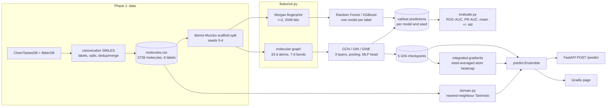

# Tantalus

Predict what a molecule tastes like (**sweet, bitter, umami, sour, salty, tasteless**) from its
structure with a graph neural network. The task is multi-label: one molecule can have several tastes.

## Approach

1. **Featurize.** SMILES strings are canonicalized with RDKit and turned into molecular graphs
   (atoms are nodes, bonds are edges in both directions) and 2048-bit Morgan fingerprints
   (radius 2).
2. **Data.** ChemTastesDB is the primary source, and BitterDB adds bitter labels. Molecules are
   deduplicated, conflicting labels are resolved, and every dropped row is logged.
3. **Split.** A Bemis–Murcko **scaffold split** keeps molecules that share a core structure on
   the same side of the split, so test molecules are structurally new to the model.
4. **Baselines.** Morgan fingerprints feed Random Forest and XGBoost. Any GNN has to beat these.
5. **GNNs.** GCN, then GIN, then an MPNN that uses bond features, built with PyTorch Geometric.
   Each label gets its own sigmoid output, trained with class-weighted binary cross-entropy.
6. **Explainability.** Atom-level attributions are drawn as heatmaps on the molecule.
7. **Demo.** A FastAPI endpoint and a Gradio page take a SMILES string and return predictions
   plus an attribution image.

Results are reported as per-label ROC-AUC and PR-AUC, with macro averages, as mean ± std over
several seeds. Accuracy is never the headline number.

## Status

Phase 0 (featurization) is mostly done, and Phase 1 (data) is done. Phase 2 (baselines) and Phase 3 (GNNs) have trained models and are waiting on scoring. Phase 4 (explainability) has started: integrated-gradients atom attributions, drawn as heatmaps on the molecule, and sanity-checked against known taste pharmacophores — bitter and umami land on the right atoms, sweet does not (the sweet attributions track molecule size). Phase 5 (demo) has started: a FastAPI endpoint and a Gradio page return seed-averaged predictions and an attribution heatmap for any SMILES, flagged when the molecule is unlike anything in the training set, and this README has the architecture diagram and limitations; the results table fills in once scoring exists. Live progress is
tracked in [`docs/roadmap.md`](docs/roadmap.md).

| Phase | Scope | State |
|---|---|---|
| 0 | Setup, featurization, exploration notebook | mostly done |
| 1 | Data loading, cleaning, merging, scaffold split | done (3728 molecules, scaffold splits for 5 seeds, class balance reported) |
| 2 | Fingerprint baselines | in progress (Random Forest and XGBoost trained on 5 scaffold splits, plus a random split for comparison; scoring next) |
| 3 | GNNs | in progress (GCN, GIN and a bond-aware MPNN (GINE) trained on 5 scaffold splits with early stopping; per-seed weights saved for Phase 4; scoring pending) |
| 4 | Explainability | in progress (integrated-gradients atom attributions for saved GNN checkpoints, rendered as RDKit heatmaps, averaged over 5 seeds and checked against known pharmacophores: bitter/umami pass, **sweet fails** — see `docs/decisions.md` 2026-11-25) |
| 5 | Demo and write-up | in progress (FastAPI `POST /predict`: SMILES -> 5-seed GIN probabilities + averaged attribution PNG; Gradio page `uv run python -m tantalus.demo`; both flag molecules outside the applicability domain; README architecture diagram and limitations written, results table waits on scoring) |

## Architecture



Every model reads the same saved splits and writes predictions in the same format, so the
baselines and GNNs are scored by one piece of code on identical test molecules. The demo serves
the GIN seed ensemble: probabilities are the mean over 5 seeds (with their std as a rough
disagreement signal), and the heatmap is the seed-averaged integrated-gradients attribution for
one label.

## Results

Headline numbers are test-set macro ROC-AUC and PR-AUC over sweet, bitter, umami and
tasteless on the scaffold split, mean ± std over seeds 0–4. Salty and sour are scored only on
the random split, as a flagged side comparison. GNN val scores are not reported, because val
chose the early-stopping epoch.

| Model | Input | Macro ROC-AUC | Macro PR-AUC |
|---|---|---|---|
| Random Forest | Morgan fingerprint | pending | pending |
| XGBoost | Morgan fingerprint | pending | pending |
| GCN | graph (atoms) | pending | pending |
| GIN | graph (atoms) | pending | pending |
| GINE | graph (atoms + bonds) | pending | pending |

All predictions exist in `data/processed/predictions/`; the table is filled once the
evaluation code (`evaluate.py`) is written.

## Setup

The project needs Python 3.12 and [uv](https://docs.astral.sh/uv/). It runs on CPU only, and
PyTorch is installed from the CPU wheel index.

```bash
uv sync
uv run python scripts/download_data.py   # fetches pinned, checksum-verified datasets into data/raw/
uv run python scripts/build_data.py      # cleaned table + scaffold splits into data/processed/
uv run python scripts/run_baseline.py random_forest  # -> data/processed/predictions/
uv run python scripts/run_baseline.py xgboost
uv run python scripts/run_baseline.py xgboost --split random  # deliberate comparison only
uv run python scripts/run_gnn.py gcn     # ~7 min on CPU, -> data/processed/predictions/gcn.csv
                                         #   (+ data/processed/checkpoints/gcn_seed<k>.pt)
uv run python scripts/run_gnn.py gin     # ~6 min on CPU, -> data/processed/predictions/gin.csv
uv run python scripts/run_gnn.py gine    # ~6 min on CPU, -> data/processed/predictions/gine.csv (bond features)
uv run python scripts/explain_molecule.py "CN1C=NC2=C1C(=O)N(C(=O)N2C)C" bitter  # heatmap PNG (needs gin checkpoints)
uv run python -m tantalus.demo           # Gradio demo on http://127.0.0.1:7860 (needs gin checkpoints)
uv run jupyter lab                       # notebooks/00_explore.ipynb
```

Development:

```bash
uv run ruff check . && uv run ruff format .
uv run pytest
```

## Layout

```
scripts/download_data.py   pinned dataset downloads (ChemTastesDB, BitterDB)
scripts/build_data.py      Phase 1 pipeline: merged table, scaffold (+ comparison random) splits, class balance
scripts/run_baseline.py    Phase 2: RF / XGBoost baselines, val/test predictions per seed
scripts/run_gnn.py         Phase 3: GNN training per seed, same prediction format as the baselines; saves per-seed checkpoints
src/tantalus/featurize.py  SMILES -> canonical SMILES, PyG graphs, Morgan fingerprints
src/tantalus/data.py       loaders (incl. shared load_split_table), scaffold/random splits, class-balance and data-quality reports
src/tantalus/models/       baselines (baselines.py: Morgan -> RF / XGBoost) and GNNs (gnn.py: GCN, GIN, GINE, load_checkpoint)
src/tantalus/train.py      GNN training loop: class-weighted BCE, early stopping on val loss
scripts/explain_molecule.py Phase 4: one molecule + label -> attribution heatmap PNG from a saved checkpoint
scripts/sanity_check_attributions.py Phase 4: known-compound panel vs. SMARTS pharmacophores, averaged over seeds
src/tantalus/explain.py    Phase 4: integrated-gradients atom attributions (per label logit), seed averaging, heatmap drawing
src/tantalus/predict.py    Phase 5: seed ensemble (5 GIN checkpoints) -> mean/std probabilities + averaged heatmap + domain check
src/tantalus/domain.py     Phase 5: applicability domain (nearest-neighbour Morgan/Tanimoto similarity to molecules.csv)
src/tantalus/api.py        Phase 5: FastAPI app (uv run uvicorn tantalus.api:app)
src/tantalus/demo.py       Phase 5: Gradio page (uv run python -m tantalus.demo)
notebooks/                 exploration, numbered by phase
docs/                      roadmap, design decisions (ADRs), learning log
```

## Data and licenses

- [ChemTastesDB](https://zenodo.org/records/15051366) v2.1: CC-BY-4.0
- [BitterDB](https://bitterdb.agri.huji.ac.il/) 2019: CC-BY-NC-ND-4.0. Its raw or merged data
  must not be redistributed, so the `data/` folder is never committed.

## Known limitations

- The scaffold split can't place acyclic or plain-benzene molecules in the test set. These two
  scaffold groups make up about 35% of the data.
- Salty and sour have too few molecules to evaluate on the scaffold split. They are reported only
  on a random split, as a deliberate side comparison.
- SMILES are stereo-free, so enantiomers count as one molecule.
- Non-sweet / non-bitter rows get all-zero labels, which treats "unknown" as "negative" for the
  other tastes.
- Umami and tasteless have only 6–10 positives in some scaffold val/test splits, so their
  per-seed AUCs are noisy.
- The model is confident on molecules unlike its training data (methane gets salty 0.79), and
  the seed std doesn't catch it. The API and demo now flag this with an applicability-domain
  check (nearest-neighbour Morgan/Tanimoto similarity < 0.3 ⇒ out of domain), but the
  probability itself is not corrected or withheld.
- Sweet attributions fail the pharmacophore sanity check: they track molecule size, probably
  because GIN sums over atoms. Bitter and umami attributions land on the expected groups.
- Heatmap colours are scaled per molecule, so intensities can't be compared across drawings.
- The current GNN checkpoints and predictions were trained before training was pinned to one
  CPU thread, so a fresh `run_gnn.py` run reproduces itself exactly but differs slightly from
  them.
